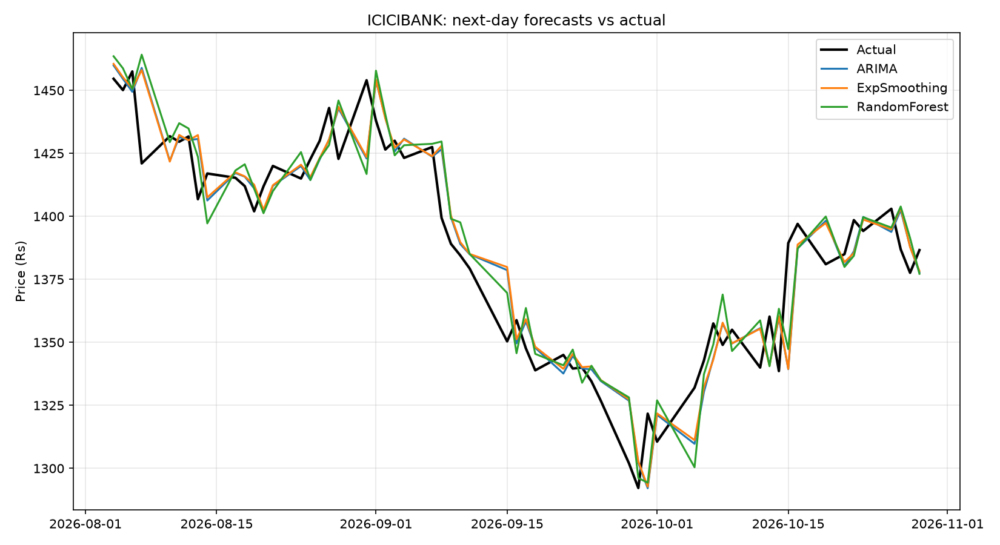

# NSE Stock Risk Dashboard

**Live app:** [your streamlit link]

## What it does
Collects 5 years of prices for 25 NSE stocks, measures risk, groups stocks into 3 risk profiles, tests forecasting models, and shows latest prices in a Streamlit dashboard.

## How it works
Yahoo Finance data, then SQLite, then risk features, then KMeans clustering and forecasting, then Streamlit app.

## Key findings
- [e.g. ICICIBANK returned about +79% in 5 years]
- [e.g. IT stocks formed a high-risk group]
- Forecast models did not clearly beat the naive baseline (see model table in the app)

## Limitations
- Only 25 stocks and 5 years of history
- Forecasting tested on [1 / 8] stocks
- Prices come from Yahoo Finance (unofficial, may be delayed)
- Educational project, not investment advice

## Tech stack
Python, pandas, SQLite, scikit-learn, statsmodels, yfinance, Streamlit

## Run locally
pip install -r requirements.txt
streamlit run app.py
